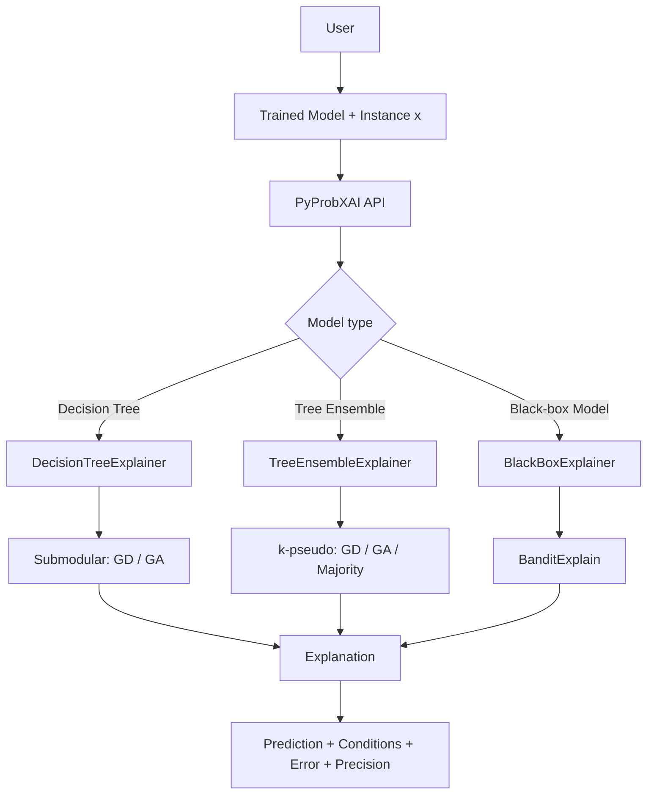

# PyProbXAI

[](https://pypi.org/project/probexplain/)
[](https://sifeddine05.github.io/PyProbXAI/)
[](https://opensource.org/licenses/MIT)
[](https://www.python.org/downloads/)

**A Python library for generating probable explanations of machine learning predictions.**

`PyProbXAI` is a Python explainability library that generates concise explanations for individual predictions. It integrates three complementary approaches to explain decision trees, tree ensembles, and black-box models, including neural networks and CNNs.

The library provides a unified interface to generate explanations without requiring users to implement the underlying algorithms.

## 1. Overview

A probable explanation is a small set of feature conditions that preserves the prediction of a classifier with high probability when the remaining features are allowed to vary.

Each explanation is characterized by:

- **Size:** number of selected conditions (at most `k`).
- **Error:** probability that the prediction changes.
- **Precision:** probability that the prediction remains unchanged (`1 - error`).

### Architecture

The library integrates three explanation approaches:



### Available explainers

| Explainer | Supported models | Methods |
|---|---|---|
| `DecisionTreeExplainer` | Decision trees | GD, GA |
| `TreeEnsembleExplainer` | Random forests, Extra Trees, Bagging | GD, GA, Majority |
| `BlackBoxExplainer` | Neural networks, CNNs, boosting and other classifiers | BanditExplain |

**Main features:**
- Unified API for different model families.
- Greedy Descent and Greedy Ascent algorithms.
- Exact error computation for individual decision trees.
- PAC-based error estimation for black-box models.
- Majority explanations for tree ensembles.
- Support for tabular, image and text classification.
- Interactive visualizations and rich HTML displays for Jupyter notebooks and standalone reports.

## 2. Installation

**Requirements:** Python >= 3.9, NumPy and Scikit-learn.

### From PyPI:

```bash
pip install probexplain
```

Optional dependency groups:
```bash
pip install "probexplain[examples]"   # to run example scripts (pandas, matplotlib, torch)
pip install "probexplain[docs]"       # to build the documentation
pip install "probexplain[all]"        # everything
```

### From GitHub:
Alternatively, clone the repository:

```bash
git clone https://github.com/SifEddine05/PyProbXAI.git
cd PyProbXAI

python -m venv .venv
```

Activate the environment:

```bash
# Windows
.venv\Scripts\activate

# Linux / macOS
source .venv/bin/activate
```

Install the library:

```bash
pip install -e .
```

To run the examples, install the additional dependencies:

```bash
pip install -r requirements-examples.txt
```

## 3. Quick Start

The simplest way to generate an explanation is to use `explain()`. The library automatically selects the appropriate explainer based on the model type.

```python
from PyProbXAI import explain

# model: fitted classification model
# x: instance to explain
e = explain(
    model,
    x,
    k=4,
    feature_names=feature_names
)

print(e)
```

For black-box models, provide a background dataset:

```python
e = explain(
    neural_network,
    x,
    k=4,
    X_background=X_train,
    eta=0.1,
    delta=0.05,
    random_state=42
)
```

Users can also instantiate an explainer directly. This is particularly useful when explaining multiple instances with the same model, since the model is analyzed only once.


```python
from PyProbXAI import (
    DecisionTreeExplainer,
    TreeEnsembleExplainer,
    BlackBoxExplainer
)

# Decision tree
explainer = DecisionTreeExplainer(model, feature_names=feature_names)
e = explainer.explain(x, k=4, method="gd")

# Tree ensemble
explainer = TreeEnsembleExplainer(model, feature_names=feature_names)
e = explainer.explain(x, k=4, method="ga")

# Black-box model
explainer = BlackBoxExplainer(
    model, X_train, eta=0.1, delta=0.05
)
e = explainer.explain(x, k=4)
```

## 4. Explanation Methods

### Decision trees — Submodular

`DecisionTreeExplainer` implements two greedy algorithms:

- **GD (Greedy Descent):** starts from the decision path of the instance and removes conditions.
- **GA (Greedy Ascent):** starts from an empty explanation and progressively adds conditions.

The explanation error is computed exactly under a uniform distribution over the Boolean variables representing the tree.

### Tree ensembles — k-pseudo

`TreeEnsembleExplainer` supports:

- **GD:** removes conditions from the direct reason.
- **GA:** progressively adds conditions using a curvature-based stopping rule.
- **Majority:** available only for Random Forest models. It seeks conditions sufficient to ensure that at least a specified number of trees predict the original class.

The ensemble explanation error is based on the weighted errors of its individual trees.

Example:

```python
e = explainer.explain(x, method="majority")
```

### Black-box models — BanditExplain

`BlackBoxExplainer` uses Monte Carlo sampling and multi-armed bandit techniques to estimate explanation errors.

It only requires access to the model's `predict()` method and a background dataset.

Its PAC guarantee is controlled by two parameters:

- `eta`: additive error tolerance.
- `delta`: probability of failure.

Categorical features can be specified using `categorical_features`, while `cat_decoders` allows their original names to appear in the explanations.

## 5. Parameters

The following table summarizes the main parameters, their expected types, descriptions, and usage examples.

| Parameter | Type | Description | Example |
|---|---|---|---|
| `k` | `int` | Maximum number of conditions in the explanation. | `k=4` |
| `method` | `str` | Explanation algorithm: `"gd"`, `"ga"` or `"majority"` where supported. | `method="gd"` |
| `feature_names` | `list[str]` | Names used to display explanation conditions. | `feature_names=["age", "income"]` |
| `eta` | `float` | Additive error tolerance for the PAC guarantee. | `eta=0.1` |
| `delta` | `float` | Probability of failure for the PAC guarantee. | `delta=0.05` |
| `X_background` | `array-like` | Background dataset used to estimate explanation errors. | `X_background=X_train` |
| `categorical_features` | `list[int]` | Indices of categorical features. | `categorical_features=[1, 3]` |
| `n_bins` | `int` | Number of quantile bins used to discretize numerical features. | `n_bins=3` |
| `cat_decoders` | `dict` | Mapping used to display original categorical values. | `cat_decoders={1: {0: "male", 1: "female"}}` |
| `random_state` | `int` or `None` | Controls random sampling for reproducibility. | `random_state=42` |

For black-box models, `eta` and `delta` default to `0.1` and `0.05`, respectively. The default number of quantile bins is `3`.

## 6. Understanding the Results

All explainers return an `Explanation` object.

| Attribute | Description |
|---|---|
| `e.prediction` | Predicted class. |
| `e.conditions` | Human-readable explanation conditions. |
| `e.features` | Indices of selected features. |
| `e.error` | Explanation error. |
| `e.precision` | Explanation precision (`1 - error`). |
| `e.size` | Number of selected conditions. |
| `e.literals` | Boolean representation of the explanation. |
| `e.n_sufficient_trees` | Number of trees with zero error (majority only). |
| `e.n_trees` | Total number of trees (majority only). |

Example output:

```text
Explanation [be] of prediction 'sci.space'

  size = 4
  error = 0.142
  precision = 0.858

  * medical = absent
  * satellite = present
  * satellites = present
  * spacecraft = present
```

### Visualization & Display

`PyProbXAI` provides built-in rich displays and interactive views tailored to different data modalities:

- **Jupyter Notebook Integration:** Evaluating an `Explanation` object in a notebook automatically renders a styled HTML card displaying certified precision, error bound and condition badges.
- **Tabular View:** `e.show_tabular(x, feature_names=...)` returns an interactive `TabularExplanationView` displaying feature values, active constraints, and invariant features that can vary freely without altering the guarantee.
- **Text View:** `e.show_text(document)` returns a `TextExplanationView` with inline highlighted words for active evidence and badges for absence guards.
- **Vision View & Plots:** `e.show_image(image, block_size=...)` returns an `ImageExplanationView` with embedded 3-panel heatmaps (original image, super-pixel heatmap, and overlay). Alternatively, `e.plot_image(image)` directly returns a Matplotlib Figure.
- **Export:** Any view can be exported to a standalone HTML file using `.save("report.html")`.

## 7. Demonstrations & Tutorials

### Interactive Tutorials (Notebooks)

Step-by-step Jupyter notebooks are available in `examples/notebooks/`:

| Notebook | Focus |
|---|---|
| `tutorial_tabular_explanation.ipynb` | Tabular explanations across Decision Trees, Random Forests, and MLPs with feature invariance inspection. |
| `tutorial_text_explanation.ipynb` | Text classification (20 Newsgroups) with document viewer and presence/absence word highlighting. |
| `tutorial_vision_explanation.ipynb` | Vision classification (MNIST CNN) with super-pixel segmentation and 3-panel heatmap visualizations. |

### Command-line Scripts

The repository also provides standalone executable scripts covering different models and data types:

| Example | Dataset | Model | Explanation approach |
|---|---|---|---|
| Decision tree | Adult | Decision Tree | Submodular |
| Random forest | Adult | Random Forest | k-pseudo |
| Neural network | Adult | MLP | BanditExplain |
| Image classification | MNIST (3 vs 8) | CNN | BanditExplain + heatmaps |
| Text classification | 20 Newsgroups | MLP | BanditExplain on words |

Run an example from the repository root:

```bash
python examples/example_1_decision_tree_adult.py
```

The example directory structure:

```text
examples/
├── data/
│   └── adult.csv
├── notebooks/
│   ├── tutorial_tabular_explanation.ipynb
│   ├── tutorial_text_explanation.ipynb
│   └── tutorial_vision_explanation.ipynb
├── example_1_decision_tree_adult.py
├── example_2_random_forest_adult.py
├── example_3_neural_network_adult.py
├── example_4_cnn_mnist_heatmap.py
└── example_5_text_be.py
```

The demonstrations illustrate:
- **Tabular data:** explanations of income predictions using decision trees, random forests and neural networks.
- **Images:** highlighted image regions showing the features selected by BanditExplain.
- **Text:** important words identified in document classification.

## 8. Scientific References

**[1]** L. Bounia and F. Koriche. *Approximating Probabilistic Explanations via Supermodular Minimization*. Proceedings of UAI 2023, PMLR 216.

**[2]** L. Bounia. *k-Pseudo-Probable Path Explanations for Weighted Tree-Based Ensembles: Bridging Interpretability and Computational Efficiency*. ECML PKDD 2026, pp. 39–57. Springer.

**[3]** S. E. Sellami, L. Bounia, J. Agoun, C. Rouveirol. *BanditExplain: Scalable Probabilistic Explanations with PAC Guarantees via Multi-Armed Bandits** [PDF](papers/BE_Paper.pdf)

---

**Repository:** https://github.com/SifEddine05/PyProbXAI

For questions, suggestions, bug reports or contributions, please use the GitHub repository.
