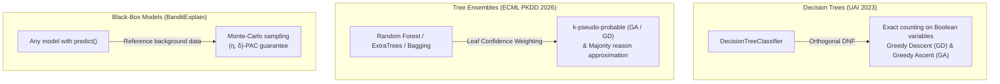

# Scientific Methodology Overview

Explainable Artificial Intelligence (XAI) methods aim to identify which elements of an instance contribute to maintaining the model's prediction.

`PyProbXAI` focuses on **probable explanations**: given a classifier $f$ and an instance $x$ with prediction $y = f(x)$, an explanation $S$ is a small set of conditions satisfied by $x$ ($x \models S$), of size at most $k$.

---

## Formal Definition of Error and Precision

When the conditions in $S$ are held fixed and the remaining features vary according to a reference distribution:

The **error** of an explanation corresponds to the probability that the prediction changes:

$$\operatorname{err}(S, x) = \Pr\big[f(x') \neq y \mid x' \models S\big]$$

The **precision** is defined as:

$$\operatorname{prec}(S, x) = 1 - \operatorname{err}(S, x)$$

The objective is to select a concise set of conditions of size $|S| \le k$ that maintains a high precision (low error).

---

## Three Families of Methods

The reference distribution used to vary features depends on the method family:

| Family | Model Type | Error Calculation | Theoretical Basis |
| :--- | :--- | :--- | :--- |
| **Decision Trees** | `DecisionTreeClassifier` | Exact counting over the Boolean variables of the tree | UAI 2023 |
| **Tree Ensembles** | `RandomForestClassifier`, `ExtraTreesClassifier`, `BaggingClassifier` | Weighted aggregation of tree errors ($k$-pseudo) & majority approximation | ECML PKDD 2026 |
| **Black-Box Models** | Any model exposing `.predict()` | Monte-Carlo estimation on reference background data | BanditExplain ($(\eta, \delta)$-PAC) |

---

## Important Methodological Differences

As noted in the paper, the library unifies methods whose assumptions and guarantees are distinct:

1. **Tree vs. Black-Box Error Distributions**:
   Errors for decision trees and tree ensembles are computed within a Boolean representation of the tree structure (uniform over the Boolean variables induced by split thresholds). Conversely, BanditExplain estimates error through Monte-Carlo sampling over an empirical reference dataset ($X_{\text{background}}$). These values should therefore not be interpreted as directly interchangeable without accounting for this difference.

2. **Majority Explanations on Ensembles**:
   The `majority` method provides an approximation of a majority explanation over the individual trees. It does not constitute an exact guarantee on the final prediction of a scikit-learn ensemble (which averages predicted class probabilities across trees rather than taking a pure majority vote).

3. **Sample Complexity in Black-Box Models**:
   For black-box models, the choice of the reference dataset and the PAC parameters $\eta$ (precision tolerance) and $\delta$ (confidence level) directly governs the number of queries to the underlying model.
